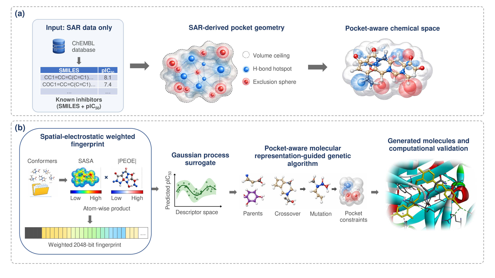

# PAMR-GA
Structure-Independent Genetic Algorithm-Based Molecular Optimization Using Pocket-Aware Molecular Representations



**(a)** A volume ceiling, hydrogen-bond hotspots and steric exclusion spheres are
reconstructed from SMILES and pIC<sub>50</sub> data alone, with no protein structure at
any stage, to define a pocket-aware chemical search space. **(b)** The
spatial-electrostatic weighted fingerprint (SEWF, SASA × |PEOE|) trains a Gaussian
process surrogate, whose predictions guide a spatially-constrained genetic
algorithm; candidates are then validated computationally.

## Overview

PAMR-GA generates candidate BACE-1 (beta-secretase 1) inhibitors with a genetic
algorithm (GA) whose fitness function is constrained by a binding-pocket model
inferred entirely from structure-activity relationship (SAR) data, without a
crystal structure or docking step. The pipeline implements:

- **Pocket-map inversion**: infers binding-pocket constraints (volume ceiling,
  hydrogen-bond hotspots, steric exclusion spheres) directly from BACE-1
  bioactivity data by contrasting activity cliffs, rather than from a resolved
  protein structure.
- **Spatial-electrostatic weighted fingerprint (SEWF) + GPR surrogate**: a
  Morgan fingerprint reweighted by per-atom solvent-accessible surface area
  (SASA) and partial equalization of orbital electronegativity (PEOE) charge,
  used to fit a Gaussian Process Regression (GPR) surrogate (Tanimoto kernel)
  that predicts pIC50 from structure alone.
- **Spatially-constrained GA**: evolves a molecular pool under crossover and
  reaction-rule-based mutation, scoring each candidate with the GPR surrogate
  penalized by fit against the inferred pocket geometry.
- **Post-hoc validation**: drug-likeness/spatial-fitness filtering of the GA
  output and Tanimoto novelty analysis against the training set.

## Requirements

Pinned in [env.yml](env.yml):

- Python 3.10
- RDKit 2022.09.5
- NumPy 1.26.4 (must stay below 2.0 — incompatible with this RDKit build)
- pandas 2.3.3, SciPy 1.15.2, scikit-learn 1.7.2, tqdm 4.70.0

All versions are pinned to those used to produce the published results.

## Installation

```bash
conda env create --file env.yml
conda activate pamr_ga
```

## Project Structure

```
PAMR-GA/
├── pamr_ga.py                    # Main GA loop: BACE-1 inhibitor generation
├── crossover.py                  # Crossover operator
├── mutate_reaction.dat           # Predefined reaction rules for mutation
├── env.yml                       # Conda environment specification
├── data/
│   ├── bace1_dataset.csv         # Curated BACE-1 bioactivity data (ChEMBL, target CHEMBL4822)
│   ├── bace1_initpool.dat        # Initial molecular pool
│   └── pocket_map.pkl            # SAR-derived binding-pocket map
├── docs/
│   └── workflow.png              # Figure 1: method overview
└── scripts/
    ├── extract_bace1_chembl.py   # Rebuild bace1_dataset.csv from a ChEMBL SQLite release
    ├── pocket_map.py             # Phase 1: infer the pocket map from SAR activity cliffs
    ├── train_gpr_peoe.py         # Phase 2/3: train the SEWF descriptor + GPR surrogate
    ├── validate_molecules.py     # Drug-likeness and spatial-fitness filtering of GA output
    └── check_novelty.py          # Tanimoto novelty analysis against the training set
```

## Usage

1. **(Optional) Regenerate the SAR-derived pocket map**

   ```bash
   python3 scripts/pocket_map.py
   ```

   Reads `data/bace1_dataset.csv`, writes `data/pocket_map.pkl`. A prebuilt
   `pocket_map.pkl` is already provided, so this step can be skipped.

2. **Train the SEWF descriptor and GPR surrogate**

   ```bash
   python3 scripts/train_gpr_peoe.py
   ```

   Reads `data/bace1_dataset.csv`, writes the descriptor matrices and the
   trained model (`models/gpr_peoe_bace1.pkl`).

3. **Run the genetic algorithm**

   ```bash
   python3 pamr_ga.py > log.dat
   ```

   Writes `results/steps/INDEX_N.dat` and `results/steps/top_mols_step_N.csv`
   per generation (selection cutoff, pool molecules, and their properties),
   plus a pooled `results/all_top_molecules.csv`. On the first run, pool
   descriptors are computed from `data/bace1_initpool.dat` and cached to
   `data/pool_sasa_peoe_descriptors.npy` / `data/pool_smiles.npy`.

4. **Validate and analyze the generated molecules**

   ```bash
   python3 scripts/validate_molecules.py
   python3 scripts/check_novelty.py
   ```

   Writes `results/validated_molecules.csv` + `results/validation_report.txt`,
   then `results/novelty_analysis.csv` + `results/novelty_report.txt`.

## Data Sources

`data/bace1_dataset.csv` is curated from [ChEMBL](https://www.ebi.ac.uk/chembl/)
(target CHEMBL4822, BACE-1) bioactivity records. It is provided pre-extracted;
to rebuild it from scratch, download a ChEMBL SQLite release and run
`scripts/extract_bace1_chembl.py --db <path/to/chembl_36.db>`.

## Reproducibility

`data/bace1_dataset.csv` and `data/pocket_map.pkl` are the exact files behind
the published results, not equivalents regenerated for release. The pocket map
was produced by `scripts/pocket_map.py` at its default settings, which are the
settings used throughout the paper, so re-running step 1 reproduces the file
that ships here.

## Citation

Manuscript in preparation. Citation details and a dataset DOI will be added on
publication.

## Notes

The trained GPR model and descriptor matrices are regenerated by the scripts
above and are not distributed with this repository.

This repository runs single-process; the version used for the reported
timings parallelises offspring evaluation across a process pool.
